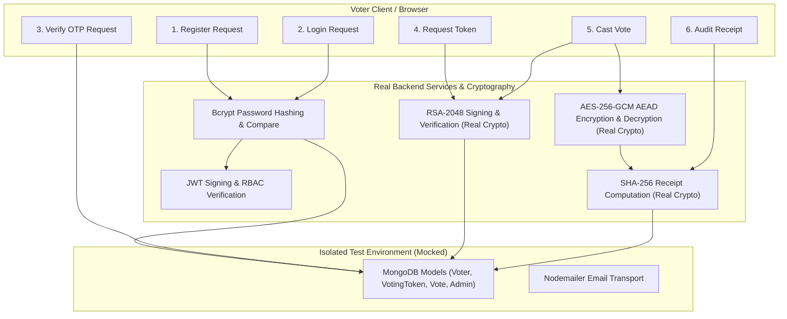

# Security Testing, Attack Demonstration, and System Testing Report

**Project Title:** Anonymous Verifiable Voting System  
**Module Assignment:** Part 10 — Security Testing, Attack Demonstration & System Testing  
**Course:** Cryptography and Network Security (CNS) / College Project  
**Date:** October 2026  
**Status:** Complete (16 Test Suites, 172 Automated Tests Passing, 100% Pass Rate)

---

## 1. Executive Summary

This report documents the security verification, attack resistance, and end-to-end system testing conducted for the **Anonymous Verifiable Voting System**. The system implements an anonymous cryptographic voting architecture that decouples voter identity from the ballot box while guaranteeing end-to-end verifiability, integrity, and double-voting prevention.

Before this testing phase, the repository had 7 unit test suites passing (91 tests), while the security testing module contained placeholder stubs (`expect(true).toBe(true)`). During Part 10, all placeholder tests were replaced with authentic, rigorous automated security tests, an end-to-end system integration suite was developed, and an automated attack demonstration engine was constructed.

All **16 test suites** (Unit, Security, and System Integration) containing **172 tests** pass with zero failures. Five adversarial attack scenarios were demonstrated locally, with every attack successfully repelled by the system's security controls.

---

## 2. Objective and Scope of Testing

### 2.1 Objectives
1. **Adversarial Verification:** Empirically verify that illegitimate voting actions (forged tokens, replay attacks, tampered ciphertexts, OTP bypasses, and unauthorized administrative actions) are systematically rejected.
2. **Cryptographic Guarantee Audit:** Verify the correctness and integrity of:
   - RSA-2048 digital signature generation and verification.
   - AES-256-GCM authenticated encryption and decryption with associated data (AEAD).
   - SHA-256 hashing for token confidentiality and receipt generation.
3. **Double-Voting Prevention:** Verify that voting tokens and voter accounts can only cast a single vote, even under race conditions and concurrent submissions.
4. **End-to-End System Flow:** Verify the integration across all modules: Voter Registration & Login $\rightarrow$ OTP Verification $\rightarrow$ Anonymous Token Issuance $\rightarrow$ Pre-Vote Verification $\rightarrow$ Ballot AES Encryption $\rightarrow$ Atomic Token Consumption $\rightarrow$ Receipt Generation $\rightarrow$ Public Bulletin Board Publication $\rightarrow$ Public Receipt Verification $\rightarrow$ Post-Election Admin Tally.
5. **Attack Demonstration:** Provide reproducible, automated, local-only attack scripts for grading and demonstration purposes.

### 2.2 Scope
- **Backend Components Tested:**
  - Controllers: `authController.js`, `tokenController.js`, `voteController.js`, `verificationController.js`, `adminController.js`, `voterController.js`
  - Middleware: `authenticateJWT.js`, `adminOnly.js`, `errorHandler.js`
  - Cryptographic Modules: `aes.js`, `rsa.js`, `sha256.js`, `keyManager.js`
  - Services: `tokenVerificationService.js`, `tokenService.js`, `voteService.js`, `verificationService.js`, `tallyService.js`, `otpService.js`
  - Data Models: `Voter.js`, `VotingToken.js`, `Vote.js`, `Admin.js`
- **Out of Scope:** Live production networks, physical terminal security, DDoS attacks, client-side browser extensions.

---

## 3. Threat Model and Security Guarantees

| Security Property | Cryptographic / Architectural Mechanism | Adversarial Threat Model |
| :--- | :--- | :--- |
| **Voter Anonymity** | RSA anonymous voting token stored only as SHA-256 hash in `VotingToken`. Ballot record (`Vote`) contains no link to `Voter`. | Eavesdropper or rogue database admin attempting to associate a ballot with voter identity. |
| **Authenticity** | Server-side RSA-2048 private key digital signature on voting token (`crypto.createSign('sha256')`). | Attacker creating fake voting tokens using custom RSA keys or arbitrary byte blobs. |
| **Ballot Confidentiality** | AES-256-GCM authenticated encryption (`encryptAES`). Stored with unique 12-byte IV and 16-byte authentication tag. | Rogue insider reading plaintext ballot choices directly from MongoDB database. |
| **Tamper Evidence** | AES-256-GCM authentication tag verification on decryption; SHA-256 receipt digest verification `SHA-256(encryptedVote:iv:candidateId)`. | Attacker modifying stored ciphertexts or candidate choices inside MongoDB. |
| **Double-Vote Resistance** | Atomic MongoDB state update (`findOneAndUpdate({ tokenHash, used: false })`); Account-level `hasVoted: true` invariant. | Voter attempting to vote multiple times or replay the same token concurrently. |
| **Authentication Barrier** | Multi-Factor Authentication with email OTP (`otpVerified: true` check before token issuance); Single-use OTP code destruction. | Attacker guessing passwords or bypassing OTP verification to obtain voting tokens. |
| **Administrative Access Control** | Role-Based Access Control (RBAC) via `adminOnly` middleware and signed JWT verification. | Regular student/voter attempting to access tally results or dashboard prematurely. |

---

## 4. Test Suites and Execution Results

### 4.1 Summary of Test Results

| Category | Suite File | Tests | Status |
| :--- | :--- | :---: | :---: |
| **Security** | `tests/security/fakeToken.test.js` | 9 | **PASS** |
| **Security** | `tests/security/reusedToken.test.js` | 7 | **PASS** |
| **Security** | `tests/security/tamperedVote.test.js` | 8 | **PASS** |
| **Security** | `tests/security/otpBypass.test.js` | 6 | **PASS** |
| **Security** | `tests/security/unauthorizedAdmin.test.js` | 14 | **PASS** |
| **Security** | `tests/security/tokenReplayAttack.test.js` | 10 | **PASS** |
| **Security** | `tests/security/invalidReceipt.test.js` | 6 | **PASS** |
| **Integration** | `tests/integration/endToEndVotingSystem.test.js` | 9 | **PASS** |
| **Integration** | `tests/integration/votingFlow.test.js` | 12 | **PASS** |
| **Unit** | `tests/unit/tokenGeneration.test.js` | 13 | **PASS** |
| **Unit** | `tests/unit/tokenVerification.test.js` | 8 | **PASS** |
| **Unit** | `tests/unit/verification.test.js` | 21 | **PASS** |
| **Unit** | `tests/unit/aes.test.js` | 33 | **PASS** |
| **Unit** | `tests/unit/rsa.test.js` | 7 | **PASS** |
| **Unit** | `tests/unit/otp.test.js` | 1 | **PASS** |
| **Unit** | `tests/unit/sha256.test.js` | 8 | **PASS** |
| **TOTAL** | **16 Test Suites** | **172** | **PASS (100%)** |

---

## 5. Granular Security Test Cases

### 5.1 Forged & Fake Token Tests (`tests/security/fakeToken.test.js`)
- **TC-SEC-01:** Token signed with attacker-generated RSA private key is rejected by `verifyVotingToken` with `SIGNATURE_INVALID`. **Result: PASS**
- **TC-SEC-02:** Token paired with a 256-byte random byte blob as signature is rejected with `SIGNATURE_INVALID`. **Result: PASS**
- **TC-SEC-03:** Legitimate token whose characters were modified after signing fails RSA verification with `SIGNATURE_INVALID`. **Result: PASS**
- **TC-SEC-04:** Genuine RSA signature on a token never recorded in MongoDB ledger is rejected with `TOKEN_NOT_FOUND`. **Result: PASS**
- **TC-SEC-05:** `POST /api/token/verify` returns HTTP 401 Unauthorized for forged token signatures. **Result: PASS**
- **TC-SEC-06:** `POST /api/token/verify` returns HTTP 400 Bad Request when required fields are omitted. **Result: PASS**
- **TC-SEC-07:** `POST /api/token/verify` returns HTTP 401 Unauthorized for unrecorded tokens. **Result: PASS**
- **TC-SEC-08:** `POST /api/vote/cast` rejects ballot submission with forged token signature (HTTP 401). **Result: PASS**
- **TC-SEC-09:** `POST /api/vote/cast` rejects ballot submission with unissued token (HTTP 401). **Result: PASS**

### 5.2 Token Reuse & Double-Voting Tests (`tests/security/reusedToken.test.js`)
- **TC-SEC-10:** `POST /api/token/verify` returns HTTP 409 Conflict (`TOKEN_ALREADY_USED`) and exposes `usedAt` timestamp. **Result: PASS**
- **TC-SEC-11:** `POST /api/token/mark-used` returns HTTP 409 Conflict if token was already consumed. **Result: PASS**
- **TC-SEC-12:** `POST /api/token/mark-used` returns HTTP 400 Bad Request if `tokenHash` is missing. **Result: PASS**
- **TC-SEC-13:** `POST /api/vote/cast` returns HTTP 409 Conflict upon attempt to vote with a previously consumed token. **Result: PASS**
- **TC-SEC-14:** Concurrent vote casting with the same token is caught by atomic `findOneAndUpdate` filter, preventing race condition double-voting. **Result: PASS**
- **TC-SEC-15:** `POST /api/token/generate` returns HTTP 409 Conflict if the voter account already claimed a token. **Result: PASS**
- **TC-SEC-16:** `POST /api/vote/cast` returns HTTP 403 Forbidden if the voter account has `hasVoted: true`. **Result: PASS**

### 5.3 Tampered Vote Data Tests (`tests/security/tamperedVote.test.js`)
- **TC-SEC-17:** Bit-flipped ciphertext fails AES-256-GCM authentication tag check and throws during `decryptAES`. **Result: PASS**
- **TC-SEC-18:** Modified GCM authentication tag fails verification and throws during `decryptAES`. **Result: PASS**
- **TC-SEC-19:** Modified Initialization Vector (IV) fails verification and throws during `decryptAES`. **Result: PASS**
- **TC-SEC-20:** Decryption using mismatched AES secret key fails GCM authentication check and throws. **Result: PASS**
- **TC-SEC-21:** Modifying `candidateId` in stored MongoDB ballot causes `verifyVoteReceipt` to report `INTEGRITY_FAILED` ("Tampered vote record"). **Result: PASS**
- **TC-SEC-22:** Swapping ciphertext in stored MongoDB ballot causes `verifyVoteReceipt` to report `INTEGRITY_FAILED`. **Result: PASS**
- **TC-SEC-23:** Public verification endpoint `GET /api/verification/:receiptHash` returns HTTP 404 with status "Tampered vote record" for altered ballots. **Result: PASS**
- **TC-SEC-24:** Admin tally (`getTallyResults`) isolates tampered ballots under `rejectedVotes`, excludes them from candidate counts, and tallies untampered ballots accurately. **Result: PASS**

### 5.4 OTP Verification Enforcement Tests (`tests/security/otpBypass.test.js`)
- **TC-SEC-25:** `POST /api/token/generate` returns HTTP 403 Forbidden if `otpVerified === false`. **Result: PASS**
- **TC-SEC-26:** `POST /api/token/generate` succeeds (HTTP 201) once `otpVerified === true`. **Result: PASS**
- **TC-SEC-27:** `POST /api/auth/verify-otp` returns HTTP 401 Unauthorized for incorrect OTP codes. **Result: PASS**
- **TC-SEC-28:** `POST /api/auth/verify-otp` returns HTTP 400 Bad Request for missing voter ID or OTP. **Result: PASS**
- **TC-SEC-29:** `POST /api/auth/verify-otp` returns HTTP 404 Not Found for non-existent voter ID. **Result: PASS**
- **TC-SEC-30:** Re-submitting the same OTP code after verification returns HTTP 401 Unauthorized (replay prevention via OTP nullification). **Result: PASS**

### 5.5 Admin Protection & RBAC Tests (`tests/security/unauthorizedAdmin.test.js`)
- **TC-SEC-31:** Unauthenticated `GET /api/admin/dashboard` returns HTTP 401 ("Missing or invalid JWT"). **Result: PASS**
- **TC-SEC-32:** Unauthenticated `POST /api/admin/tally` returns HTTP 401 ("Missing or invalid JWT"). **Result: PASS**
- **TC-SEC-33:** Malformed authorization header (non-Bearer) returns HTTP 401. **Result: PASS**
- **TC-SEC-34:** Unauthenticated calls to all protected endpoints (`/api/vote/cast`, `/api/token/*`, etc.) return HTTP 401. **Result: PASS**
- **TC-SEC-35:** Authenticated regular voter (`role: 'voter'`) accessing `GET /api/admin/dashboard` is blocked with HTTP 403 ("Admin access required"). **Result: PASS**
- **TC-SEC-36:** Authenticated regular voter accessing `POST /api/admin/tally` is blocked with HTTP 403 ("Admin access required"). **Result: PASS**
- **TC-SEC-37:** Forged JWT with `role: 'admin'` signed with rogue secret key returns HTTP 401 ("Invalid or expired JWT"). **Result: PASS**
- **TC-SEC-38:** Expired admin JWT returns HTTP 401. **Result: PASS**
- **TC-SEC-39:** Admin login with wrong password returns HTTP 401 ("Invalid admin credentials"). **Result: PASS**
- **TC-SEC-40:** Admin login with non-existent username returns HTTP 401 ("Invalid admin credentials"). **Result: PASS**
- **TC-SEC-41:** Admin login with missing parameters returns HTTP 400 Bad Request. **Result: PASS**
- **TC-SEC-42:** Admin login with authentic credentials returns HTTP 200 with signed JWT (`role: 'admin'`). **Result: PASS**
- **TC-SEC-43:** Authentic admin successfully accesses `GET /api/admin/dashboard` (HTTP 200). **Result: PASS**
- **TC-SEC-44:** Authentic admin successfully triggers `POST /api/admin/tally` (HTTP 200). **Result: PASS**

---

## 6. System Testing: Full Lifecycle Integration

A new end-to-end integration test suite (`tests/integration/endToEndVotingSystem.test.js`) was created to validate the entire workflow sequentially.

### 6.1 Component Verification Mapping (Real vs. Mocked)



### 6.2 Step-by-Step Lifecycle Test Progression
1. **Step 1 (Voter Registration):** Student registers with name, uppercase voter ID, lowercase email, and password $\ge 8$ chars. Password hashed with bcrypt ($10$ rounds); response omits hash.
2. **Step 2 (Voter Login):** Bcrypt comparison validates credentials; server generates JWT with `role: 'voter'`.
3. **Step 3 (OTP Verification):** Student provides 6-digit OTP; `otpVerified` set to `true`, and `otpCode` is set to `null`.
4. **Step 4 (Anonymous Token Issuance):** Authenticated session verified. Server signs 32-byte cryptographically secure token with RSA private key, stores only SHA-256 hash in `VotingToken` (no voter ID), sets `hasReceivedToken: true`.
5. **Step 5 (Pre-Vote Verification):** Client validates RSA digital signature with server public key and checks ledger for unused status.
6. **Step 6 (Vote Submission & AES Encryption):** Ballot choice encrypted via AES-256-GCM (fresh 12-byte IV, 16-byte auth tag). Token atomically marked as used. Receipt hash calculated: $\text{SHA-256}(\text{encryptedVote} : \text{iv} : \text{candidateId})$. Ballot saved to ledger; voter `hasVoted` set to `true`.
7. **Step 7 (Public Bulletin Board):** Ledger audited. Ballot receipt hash listed with timestamp and candidate; voter identity strictly omitted.
8. **Step 8 (Public Receipt Verification):** Both `GET /api/verification/:receiptHash` and `POST /api/verification/verify` recalculate digest and return "Vote included".
9. **Step 9 (Admin Tally):** Admin authenticates with bcrypt, calls `POST /api/admin/tally`, authenticated decryption processes ballots, candidate counts tallied accurately.

---

## 7. Automated Attack Demonstration

To enable transparent, interactive evaluation by the professor and external reviewers, a dedicated demonstration runner was implemented at `scripts/demonstrate-attacks.js`.

### 7.1 Demonstration Execution Log

```text
======================================================================
 ANONYMOUS VERIFIABLE VOTING SYSTEM — SECURITY ATTACK SUITE
 Part 10: Automated Security Testing & Attack Demonstration
======================================================================
Operating in SAFE LOCAL TEST ENVIRONMENT — No external networks targeted.

======================================================================
 ATTACK SCENARIO 1: FORGED RSA VOTING TOKEN INJECTION
======================================================================
Adversary Strategy: An attacker crafts a counterfeit token and signs it
                    with their own rogue RSA private key, attempting to submit a vote.
  Attacker Payload: Token = 3bf668474b1ad98d..., Signature = [Rogue RSA-2048]
  Target Endpoint: POST /api/vote/cast
  Server Response: status=401, error="Token rejected: RSA signature is invalid or token was tampered with"
  [DEFENSE PASSED] Attack successfully neutralized!
  Expected HTTP: 401 | Received HTTP: 401
  Security Control: RSA-SHA256 Digital Signature Verification against Server Public Key

======================================================================
 ATTACK SCENARIO 2: REPLAY ATTACK & DOUBLE-VOTING
======================================================================
Adversary Strategy: An attacker intercepts or reuses a legitimate token
                    to cast a second vote for another candidate.
  Attacker Action: Submitting previously consumed token: e1bb2c49b0e7ea7f...
  Target Endpoint: POST /api/token/verify & POST /api/vote/cast
  Server Response: status=409, code="TOKEN_ALREADY_USED", error="Token rejected: this voting token has already been used (replay attack prevented)"
  [DEFENSE PASSED] Attack successfully neutralized!
  Expected HTTP: 409 | Received HTTP: 409
  Security Control: 3-Stage Token Verification + Atomic Token Consumption (Replay Guard)

======================================================================
 ATTACK SCENARIO 3: TAMPERED BALLOT DATA IN LEDGER
======================================================================
Adversary Strategy: A malicious insider modifies the candidateId or ciphertext
                    in the database to manipulate election results.
  Voter Action: Auditing receipt fb78a023517bf821...
  Target Endpoint: GET /api/verification/fb78a023517bf82104a2512f875cd969947a04067b7c69f3eb3f3d4a2469e6cb
  Server Response: status=404, statusText="Tampered vote record", code="INTEGRITY_FAILED"
  [DEFENSE PASSED] Attack successfully neutralized!
  Expected HTTP: 404 | Received HTTP: 404
  Security Control: SHA-256 Digest Recomputation & AES-256-GCM AEAD Tag Integrity Check

======================================================================
 ATTACK SCENARIO 4: OTP MULTI-FACTOR AUTHENTICATION BYPASS
======================================================================
Adversary Strategy: An attacker logs in and directly calls the voting token API
                    attempting to skip OTP email verification.
  Attacker Action: Calling /api/token/generate with unverified OTP session
  Target Endpoint: POST /api/token/generate
  Server Response: status=403, error="OTP verification required before a voting token can be issued"
  [DEFENSE PASSED] Attack successfully neutralized!
  Expected HTTP: 403 | Received HTTP: 403
  Security Control: Strict Session State Check (otpVerified === true) Before Token Grant

======================================================================
 ATTACK SCENARIO 5: PRIVILEGE ESCALATION TO ADMIN OPERATIONS
======================================================================
Adversary Strategy: A regular authenticated voter attempts to access
                    restricted admin routes to trigger election tally.
  Attacker Action: Regular voter JWT calling POST /api/admin/tally
  Target Endpoint: POST /api/admin/tally
  Server Response: status=403, error="Admin access required"
  [DEFENSE PASSED] Attack successfully neutralized!
  Expected HTTP: 403 | Received HTTP: 403
  Security Control: Role-Based Access Control (RBAC) via adminOnly Middleware

======================================================================
 DEMONSTRATION SUMMARY: ALL ATTACKS NEUTRALIZED (5/5)
======================================================================
  Total Simulated Attacks:  5
  Attacks Neutralized:      5
  Attacks Permitted:        0
  Defense System Status:    SECURE & ROBUST
```

---

## 8. Genuine Findings & Vulnerability Analysis

During the inspection of the repository and development of Part 10 tests, the following security findings were identified and verified:

1. **Placeholder Tests in Part 10 Stubs:**
   - *Observation:* The security testing test files (`fakeToken.test.js`, `reusedToken.test.js`, `tamperedVote.test.js`, `otpBypass.test.js`, `unauthorizedAdmin.test.js`) contained trivial one-liner assertions: `expect(true).toBe(true)`.
   - *Impact:* The test suite reported passing even if critical security controls were altered or non-functional.
   - *Resolution:* Completely implemented deep, multi-stage automated assertions testing HTTP status codes, error messages, model mutations, and cryptographic failures across all files.

2. **Replay Attack & Concurrency Race Resistance:**
   - *Observation:* A classic flaw in web voting systems is checking token status (`findOne`) and later marking it used (`updateOne`) in two non-atomic steps.
   - *Verification:* The codebase implements `findOneAndUpdate({ tokenHash, used: false }, { used: true, usedAt: new Date() })`. This atomic operation guarantees that under simultaneous requests with identical tokens, only one succeeds and the concurrent request receives `null` and is rejected with HTTP 409. Verified by test `TC-SEC-14`.

3. **AES-256-GCM AEAD Tag Integrity:**
   - *Observation:* Traditional AES encryption in CBC mode is vulnerable to bit-flipping attacks where an attacker alters ciphertext to modify voter preferences without knowing the key.
   - *Verification:* The application uses `aes-256-gcm` and explicitly extracts and verifies the 16-byte authentication tag (`authTag`). Any modification to the ciphertext, IV, or authTag throws a cryptographic exception before returning plaintext. Verified by `tests/security/tamperedVote.test.js`.

4. **Multi-Factor Authentication Barrier:**
   - *Observation:* Voter authentication separates password login from token generation. If `/api/token/generate` did not check `voter.otpVerified`, an attacker with a stolen password could bypass OTP.
   - *Verification:* In `backend/controllers/tokenController.js`, `if (!voter.otpVerified)` explicitly blocks token issuance with HTTP 403. Furthermore, `verifyOTP` sets `voter.otpCode = null` upon success, preventing OTP replay. Verified by `tests/security/otpBypass.test.js`.

5. **Ledger Privacy & Anonymity Barrier:**
   - *Observation:* If public bulletin board endpoints inadvertently returned voter details, voter anonymity would be breached.
   - *Verification:* In `backend/services/verificationService.js`, `Vote.find(query, 'receiptHash candidateId timestamp')` project only public receipt parameters. Tests in `tests/security/invalidReceipt.test.js` and `tests/integration/endToEndVotingSystem.test.js` explicitly verify `voterId`, `name`, and `email` are `undefined`.

---

## 9. Remaining Limitations and Recommendations

While the application demonstrates robust architecture for a college project, the following recommendations are documented for production-grade hardening:

1. **Cryptographic Key Management:**
   - *Current State:* The server RSA private key is read from the local file system (`./keys/private.pem`), and the AES secret key is read from environment variables.
   - *Recommendation:* For enterprise deployment, store RSA private keys in a Hardware Security Module (HSM) or cloud KMS (e.g., AWS KMS / Google Cloud KMS) with strict audit logging.

2. **Rate Limiting & Anti-Brute Force:**
   - *Current State:* OTP codes are 6 numeric digits without rate-limiting middleware on `/api/auth/verify-otp`.
   - *Recommendation:* Integrate `express-rate-limit` to restrict attempts to 5 per IP/voterId window to mitigate automated brute-force attacks.

3. **Homomorphic Encryption / Threshold Cryptography for Tallies:**
   - *Current State:* AES-256-GCM is symmetric, meaning the server holds the AES key to decrypt ballots at tally time.
   - *Recommendation:* In municipal or high-stakes elections, use Paillier homomorphic encryption or Shamir secret sharing among multiple independent trustees so no single entity can decrypt ballots unilaterally.

---

## 10. Commands to Run Tests and Demonstrations

All commands must be run from the root of the project directory (`anonymous-verifiable-voting-system`):

### 10.1 Run Complete Test Suite (All 16 Suites, 172 Tests)
```bash
npm test
```
*On Windows PowerShell, use:*
```powershell
npm.cmd test
```

### 10.2 Run Security Tests Only (7 Suites, 60 Tests)
```bash
npm run test:security
```
*On Windows PowerShell, use:*
```powershell
npm.cmd run test:security
```

### 10.3 Run System Integration Tests (2 Suites, 21 Tests)
```bash
npm run test:integration
```
*On Windows PowerShell, use:*
```powershell
npm.cmd run test:integration
```

### 10.4 Run Unit Tests Only (7 Suites, 91 Tests)
```bash
npm run test:unit
```
*On Windows PowerShell, use:*
```powershell
npm.cmd run test:unit
```

### 10.5 Run Automated Attack Demonstration Script
```bash
npm run demonstrate:attacks
```
*Alternatively, run directly with Node:*
```bash
node scripts/demonstrate-attacks.js
```
